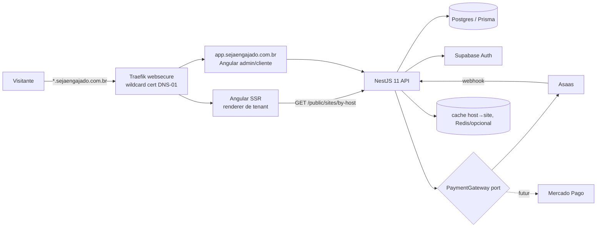

# Seja Engajado — Plano (v1.1, 14/10/2026)

## 1. Análise das referências
### Nour Bio Site — https://nourbiosite.com.br/ (lido em 14/10/2026)
- **Proposta:** "Vá além da plaquinha". Ferramenta para **revendedor** de plaquinha (NFC/QR de avaliação Google) criar na visita, pelo celular, um mini site do cliente e ganhar recorrência.
- **Público:** vendedores porta a porta/revendedores de plaquinhas; cliente final = pequeno negócio local.
- **Preços publicados (para o revendedor):** teste grátis 7 dias (3 sites, 1 agenda, sem cartão); R$ 29,90/mês mensal ou R$ 19,90/mês semestral; White Label R$ 99,90/mês (marca e domínio próprios, rodapé com contatos, Agenda Online); Painel do Cliente R$ 9,90 por bio/mês. Entrega única: bios ilimitadas, sem custo por bio. Sem fidelidade.
- **Preços que ela *sugere* ao revendedor cobrar:** criação R$ 250 a R$ 499,90; mensalidade do painel R$ 49,90 a R$ 99,90; plaquinha (exemplo dela) venda R$ 80 e custo R$ 13.
- **Dois produtos:** *Entrega única* (o revendedor monta, o cliente não edita) x *Painel do Cliente* (o cliente edita preços, fotos, promoções, Pix e horários; o login é por código enviado por e-mail, sem senha; o revendedor recebe aviso a cada mudança). É o mesmo modelo que o Tarciso descreveu.
- **Blocos dos sites:** WhatsApp, Instagram, mapa, avaliação Google, Tripadvisor, YouTube, foto no topo, logo/cores/fonte (cores extraídas da logo), promoção com contagem regressiva, mini catálogo (até 12 produtos) com carrinho que gera pedido no WhatsApp, Pix com QR, Wi-Fi com QR, botões iFood/99Food, Calendly. Em breve: Agenda Online e cashback.
- **Fluxo:** escolher o modelo (mais de 100, para 54 ramos, em 2 versões) → importar os dados do Google (endereço, telefone, horário, avaliação) → logo e cores → entregar o link. URL `nourbiosite.com.br/b/nome-da-empresa` (caminho, **não subdomínio**).
- **Painel do revendedor (inferido):** CRM com clientes, visitas, financeiro, metas e estoque de plaquinhas; **Leads** (busca no Google por cidade, bairro e ramo, filtrando quem não tem site; exportar e montar rota); curso de vendas. Se o plano vence, as bios ficam no ar por 7 dias.
- Instagram @nourbiosite: não consultado (exige login, e não criei conta). A página não linka sites de clientes, então nenhum exemplo foi aberto.

### rea.tools — https://rea.tools/
- **Não é concorrente.** É o "REA", uma ferramenta de engenharia reversa para agentes de código (`npx rea-agents`). Sem relação com sites locais nem com placas — descartado como referência.

## 2. Nosso diferencial
- Placa de avaliação Google (QR+NFC) **física, entregue com o site**, com o QR apontando para `cliente.sejaengajado.com.br/avaliar` (redirect rastreável → link de review do Google). Com isso, medimos scans.
- **Subdomínio próprio** (melhor percepção e SEO local do que um /b/caminho) e SSR.
- **Foco em Uberaba-MG:** atendimento presencial, vitrine "negócios de Uberaba" (opcional), modelos por ramo local.
- Venda direta (B2C local) **e** por revendedor (B2B2C) desde o modelo de dados.

## 3. Personas
1. **Dona Ana — salão/barbearia:** vive no WhatsApp/Instagram; quer agenda e avaliação. Não edita nada → plano único.
2. **Marcos — lanchonete/pizzaria:** muda cardápio e promoção toda semana → plano mensal.
3. **Revendedor de plaquinhas:** quer produto recorrente e painel com seus clientes e comissões.
4. **Tarciso (admin):** quer receita, sites por cliente/revendedor, cupons e inadimplência.

## 4. Planos (⚠️ preços de venda = HIPÓTESE A VALIDAR com 5 a 10 negócios de Uberaba)
| Plano | O que inclui | Hipótese de preço |
|---|---|---|
| **Pronto** (pagamento único) | site entregue, sem edição pelo cliente, alterações via suporte; **hospedagem anual** (1º ano incluso na venda; renovação anual barata, hipótese R$ 99–149/ano, valor configurável no admin) | R$ 297 a R$ 397 único |
| **Mensal (Engajado Pro)** | painel de edição, catálogo, Pix, promoções; **placa de brinde** com fidelidade de 12 meses (cancelamento antes cobra a multa da placa, fórmula abaixo, valor gravado no cancelamento) | R$ 49,90 a R$ 79,90/mês + adesão opcional |
| **Revendedor** | N sites; plataforma cobra do revendedor o **atacado por site ativo** via Asaas (fase 1), pela **foto no fechamento** (não pelo pico do mês); o revendedor cobra o cliente final por fora e fica com a margem | hipótese: mensalidade + valor por site ativo |

**Placa:** brinde **somente no plano mensal** (com fidelidade). No Pronto a placa é add-on pago (hipótese +R$ 60 a R$ 90), sem fidelidade.

**Multa da placa** (só se `hoje < plaqueFidelityEndsAt`, datas civis em `America/Sao_Paulo`):

```
diasRestantes = data(plaqueFidelityEndsAt) − hoje
mesesRestantes = ceil(diasRestantes / 30)
multaCentavos = floor(plaqueValueCentavos × mesesRestantes × plaquePenaltyPct / 1200)
```

Só o mês arredonda para cima. O valor fica em centavos inteiros (divisão inteira, sem arredondar o dinheiro para cima). Se `diasRestantes <= 0`, `multaCentavos = 0`. O evento de cancelamento grava `plaqueValueCentavos`, `plaquePenaltyPct`, `diasRestantes`, `mesesRestantes` e `multaCentavos`; a Order usa esse valor gravado. Mudar o preço da placa no admin depois não altera a fatura.

**Nome do plano mensal:** *Engajado Pro* (reforça a marca). Alternativas descartadas: Vitrine Viva, Sempre Atual, Meu Painel, Engajado Livre.

Referência de mercado: as faixas sugeridas pela Nour (seção 1).

### Regras de atraso e inadimplência (configuráveis no admin)
`diasAtraso = diff(hoje, currentPeriodEnd)` em dias de calendário, fuso `America/Sao_Paulo`. No dia do vencimento, `diasAtraso = 0`. O dia 1 é o dia seguinte. Todas as faixas usam `>=`:

- `diasAtraso >= 1` e `< 8`: só avisos (e-mail/WhatsApp);
- `>= 8` e `< 16`: painel do cliente só leitura; site permanece no ar;
- `>= 16` e `< 60`: site suspenso com página "temporariamente indisponível";
- `>= 60`: site arquivado.

Defaults: aviso a partir de 1, só leitura a partir de 8, suspensão a partir de 16, arquivo a partir de 60. O job diário é idempotente: a mesma entidade, o mesmo tipo de aviso e a mesma data em São Paulo não disparam um segundo envio. Reativação automática ao pagar (webhook Asaas).

**Revendedor inadimplente (`DELINQUENT`, automático):** sites dos clientes ficam **30 dias** no ar; criação de site novo bloqueada; após 30 dias o admin pode oferecer migração do cliente final para a plataforma direta. Esse prazo vale só para inadimplência comum.

**Revendedor bloqueado (`BLOCKED`, só manual):** o admin informa motivo obrigatório e o log grava ator, motivo e sites. Criação de site novo trava na hora. Os sites ligados à fraude (os que o admin indicar) passam a `SUSPENDED` imediatamente, sem os 30 dias. Desbloquear volta o revendedor a criar sites e não republica os sites suspensos.

**Site ativo na fatura do revendedor:** status `PUBLISHED` ou `READ_ONLY` na foto do instante do fechamento. A fatura grava a lista de sites, a contagem, a mensalidade e o custo por site daquele momento.

## 5. MVP x Depois
**MVP (fase 1):** hierarquia admin > revendedor > cliente; painel do revendedor (mobile-first: criar sites, definir preço, financeiro, metas, estoque de placas); landing; admin (clientes, sites, planos, cupons, receita, configs de atraso/renovação/multa da placa); painel do cliente (formulário, edição liberada só no plano mensal); 3 templates; subdomínio automático com wildcard; checkout **Asaas** (PIX/cartão/assinatura, sandbox) por webhook; cobrança do revendedor (mensalidade + atacado por site ativo) e do cliente direto; renovação anual do Pronto; jobs de atraso/suspensão/arquivamento; redirect `/avaliar` com contagem de scans; login por OTP de e-mail (Supabase). Na fase 1 o revendedor cobra o cliente final **por fora** e fica com a margem.

**Fase 2:** domínio próprio como **add-on pago** (SSL via Cloudflare for SaaS / custom hostnames); cobrança automática opcional do cliente final do revendedor via Asaas com **split**; adapter Mercado Pago; busca de leads; importação do Google Places; catálogo com carrinho e pedido no WhatsApp; Wi-Fi QR; agenda; analytics.

**Fase 3:** white label para revendedor (plano superior), após ~5 revendedores ativos.

## 6. Arquitetura

- Host → tenant: o SSR lê o `Host`, chama a API (com cache de 60 s) e renderiza `template.key` com `site.content` (JSON validado por um schema do template). Raiz e `app.` são reservados.
- Sem criação de certificado por cliente no MVP: um único wildcard cobre todos os subdomínios. O "provisionamento" é só um registro no banco. Domínio próprio (fase 2) usa Cloudflare for SaaS / custom hostnames.

## 7. Modelo de dados (Prisma, resumo)
- `User`(id, supabaseId, email, role ADMIN|RESELLER|CUSTOMER) — papel 'revendedor' = RESELLER
- `Reseller`(id, userId, nome, resellerPlanId, status ACTIVE|DELINQUENT|BLOCKED, delinquentSince?, blockedAt?, blockReason?, asaasWalletId? (split fase 2)) — `BLOCKED` só por ação manual do admin, com `blockReason` obrigatório
- `ResellerPlan`(id, nome, mensalidadeCentavos, custoPorSiteAtivoCentavos, limiteSites?)
- `ResellerPrice`(resellerId, planId, precoCentavos) — quanto o revendedor cobra do cliente (fora da plataforma na fase 1)
- `ResellerGoal`(resellerId, mes, metaSites, metaReceita) · `PlaqueStock`(resellerId, tipo, qtd, custoMedio)
- **Isolamento:** toda entidade de cliente/site/pagamento carrega `resellerId` (null = venda direta do admin); guards + filtro Prisma por `resellerId`
- `Customer`(id, userId?, resellerId?, nome, doc, whatsapp, cidade)
- `Site`(id, customerId, slug @unique, customDomain? @unique, templateId, content Json, status DRAFT|PUBLISHED|READ_ONLY|SUSPENDED|ARCHIVED, planId, editable bool, publishedAt, hostingRenewsAt?, plaqueFidelityEndsAt?)
- `Template`(id, key, nome, ramo, schema Json, ativo)
- `Plan`(id, code, nome, tipo ONE_TIME|RECURRING|ANNUAL_HOSTING, precoCentavos, intervalo?, features Json)
- `PlatformConfig`(chave, valor) — prazos de atraso (aviso/só leitura/suspensão/arquivamento), valor renovação anual Pronto, valor/multa da placa, dias de graça do revendedor inadimplente
- `Coupon`(id, code @unique, tipo PCT|FIXED, valor, validade, maxUsos, usos, planIds[])
- `Order`(id, customerId, siteId, planId, couponId?, valorBruto, desconto, valorLiquido, status)
- `Subscription`(id, siteId?, resellerId?, gateway, gatewaySubId, status, currentPeriodEnd)
- `Payment`(id, orderId?, subscriptionId?, gateway, gatewayPaymentId, metodo PIX|CARD|BOLETO, valor, status, paidAt)
- `WebhookEvent`(id, gateway, eventId @unique([gateway,eventId]), payload Json, processedAt)
- `Plaque`(id, siteId?, tipo QR|NFC, codigo, status ESTOQUE|ENTREGUE, valorCentavos?, giftedBool), `ScanEvent`(id, siteId, ts, ipHash)
- `Cancellation`(id, siteId, subscriptionId, plaqueValueCentavos, plaquePenaltyPct, diasRestantes, mesesRestantes, multaCentavos, orderId, createdAt) — snapshot da multa; a Order não recalcula
- `ResellerInvoice`(id, resellerId, mes @unique([resellerId, mes]), closedAt, mensalidadeCentavos, custoPorSiteAtivoCentavos, activeSiteIds[], totalCentavos) — foto no fechamento (`PUBLISHED`|`READ_ONLY`)
- `NoticeLog`(entityType, entityId, kind, localDate @unique([entityType, entityId, kind, localDate])) — um aviso por entidade, tipo e dia em `America/Sao_Paulo`
- `ReservedSlug`(slug), `AuditLog`(actor, acao, entidade, diff) — bloqueio de revendedor grava motivo e sites suspensos

## 8. Riscos e mitigação
- **LGPD:** coletar o mínimo; termos e política; contrato de operador com o cliente; hash de IP nos scans; exportação e exclusão a pedido; logs sem dados pessoais.
- **Abuso de subdomínio / phishing:** slugs reservados (www, app, api, admin, mail, login, pix, banco, gov…) e um blocklist de marcas; publicação só depois do pagamento ou da aprovação do admin; sem HTML/JS livre (blocos estruturados); links externos validados; botão "denunciar"; suspensão rápida. Lembrar que um subdomínio malicioso afeta a reputação do domínio inteiro (Safe Browsing).
- **Conteúdo impróprio:** moderação no admin, upload de imagens só com tipos permitidos e tamanho máximo, revisão antes de publicar.
- **Rate limit:** `@nestjs/throttler` na API (auth, OTP, webhooks, by-host); rate limit no Traefik; cache do SSR.
- **Let's Encrypt:** o wildcard evita o limite de 50 certificados por domínio registrado por semana. Domínios próprios (fase 2, Cloudflare for SaaS) não dependem de emitir um cert LE por cliente no Traefik. Usar o staging nos testes. A renovação do DNS-01 depende do token da API de DNS, que deve ficar em Docker secret.
- **Gateways:** webhooks duplicados ou fora de ordem → idempotência por `eventId` e reconsulta do status no gateway.
- **Dependência do Supabase:** isolar atrás de um `AuthGuard`, validando o JWT pelo JWKS.

## 9. Blocos de entrega
1. **Front mock** (cursor-01). Pronto quando a landing, o admin, o painel do cliente e 3 templates navegam com mock e `?host=` simula o subdomínio.
2. **Backend base** (cursor-02, blocos 1 a 3). Pronto quando a API sobe em Docker local, o Prisma migra, o auth Supabase protege as rotas e os testes passam.
3. **Sites, templates e host→tenant** (cursor-02). Pronto quando `GET /public/sites/by-host` retorna o site certo e o front SSR consome isso.
4. **Planos, cupons e relatórios** (cursor-02). Pronto quando o cálculo de desconto está testado e o relatório de receita por período e por revendedor fecha com as seeds.
5. **Pagamentos** (cursor-03). Pronto quando o PIX e a assinatura no sandbox Asaas ativam o site via webhook, e um webhook repetido não duplica nada.
6. **Infra** (cursor-04, execução pelo Atlas com OK do Tarciso). Pronto quando `https://teste.sejaengajado.com.br` responde com o certificado wildcard válido e há backup diário restaurável.
7. **Piloto Uberaba:** 5 clientes reais, validação de preço e coleta de feedback.

**DNS (DECIDIDO):** zona delegada à **Cloudflare** (registro segue na Hostinger, trocar NS lá); `*.sejaengajado.com.br` + raiz + `app`; Traefik `dnsChallenge.provider=cloudflare` com token de API restrito a Zone:DNS:Edit desta zona, como Docker secret (`CF_DNS_API_TOKEN_FILE`), nunca no repo.

## 10. Decisões (14/10/2026)
- ✅ Revendedores no MVP (admin > revendedor > cliente); split Asaas na fase 2 (opcional); leads opcional depois.
- ✅ DNS na Cloudflare (registro na Hostinger).
- ✅ Gateway: Asaas primeiro; Mercado Pago fora do MVP (interface mantida).
- ✅ rea.tools descartado como referência (não é concorrente).
- ✅ **Plano Pronto:** hospedagem anual (1º ano incluso; renovação anual barata R$ 99–149/ano, configurável no admin). Placa de brinde **só no mensal**, com fidelidade de 12 meses.
- ✅ **Multa da placa:** `mesesRestantes = ceil(diasRestantes / 30)`; `multaCentavos = floor(plaqueValueCentavos × mesesRestantes × plaquePenaltyPct / 1200)`; só o mês arredonda para cima; snapshot gravado no `Cancellation` (a fatura não muda se o admin alterar o preço depois).
- ✅ **Atraso do mensal:** `diasAtraso` em dias civis, `America/Sao_Paulo`, dia 1 = dia seguinte ao `currentPeriodEnd`. Faixas com `>=`: avisos desde 1, só leitura desde 8, suspenso desde 16, arquivado desde 60. Job idempotente via `NoticeLog` (não reenvia no mesmo dia).
- ✅ **Site ativo (fatura do revendedor):** `PUBLISHED` e `READ_ONLY`, foto no fechamento (`ResellerInvoice`), não o pico do mês.
- ✅ **Revendedor `DELINQUENT`:** sites 30 dias no ar; sem criar site novo; depois o admin pode oferecer migração. **`BLOCKED`:** só manual, motivo obrigatório e `AuditLog`; trava criação e suspende na hora os sites ligados à fraude. Os 30 dias não se aplicam ao bloqueio.
- ✅ **Cobrança do cliente final do revendedor:** fase 1 — revendedor cobra por fora e fica com a margem; plataforma cobra do revendedor o atacado por site ativo via Asaas. Fase 2 — cobrança automática opcional via Asaas com split.
- ✅ **Roadmap:** domínio próprio na fase 2 como add-on pago (SSL via Cloudflare for SaaS / custom hostnames); white label para revendedor na fase 3, plano superior, após ~5 revendedores ativos.
